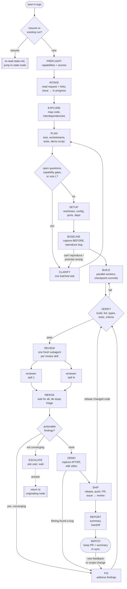

# pwn-it: own a piece of work from start to finish

Agentic harness for development work. You are the **orchestrator**: you own the outcome, keep
the run state, make the decisions, and delegate bounded work to subagents.

How to read this skill:

- **The graph** (below) is the control flow. Every run is a walk through it.
- **Node contracts** say, for each node, what to do, what must be true to leave it (the *exit
  gate*), and where to go next. Never leave a node without meeting its exit gate.
- **The run state file** is your memory. The conversation can be compacted or the session
  restarted (e.g. to enable Chrome); the state file is what makes the run resumable. If it isn't
  in the state file, assume you'll forget it.
- **References** in `references/` hold the detailed procedures. Read the one a node points to
  when you enter that node, not before.

Skill directory (`$SKILL`): the directory holding this `SKILL.md`, i.e. the "Base directory for
this skill" Claude Code shows when the skill loads. Use that absolute path; never assume where the
skill is installed.

Data directory (`$PWN_IT_HOME`): `$PWN_IT_HOME` if set in the environment, else `~/.claude/pwn-it/`.
It holds everything pwn-it writes and keeps between runs; the skill directory is never written to.

```
$PWN_IT_HOME/
  config.json          # optional; review skills (see REVIEW)
  runs/<RUN_ID>/       # one per run (see Run state)
  repos/<repo>.md      # repo profiles, from $SKILL/templates/repo-profile.md
  repos/<repo>.copy-ignored   # extra gitignored paths setup-worktree.sh copies (one per line, # comments)
  LEARNINGS.md         # friction with this skill, appended at REPORT
```

Primary repo (`$REPO`): `git rev-parse --show-toplevel` from the directory the skill was invoked in.
The skill is always run from the root of the target repo; don't search the disk for repos.

"Ticket" in this skill means a GitHub issue. Its **key** is `<repo>-<number>` (e.g. `api-123`
for `#123` in repo `api`), used wherever a filesystem- or branch-safe name is needed; refer to it
as `#123` (or `owner/repo#123` across repos) in PRs, commits, and comments.

## Invocation and routing

| Arguments | Route |
| --- | --- |
| Any mix of GitHub issue URLs/numbers (e.g. `#123`, `owner/repo#123`) and doc paths | New run, start at `PREFLIGHT`. All of them together are **one combined unit of work** (see below). Docs are either request or supporting material; work out which in `INTAKE` |
| `resume <RUN_ID> [what changed]` | Re-read the run's `state.md`, then this file's contract for its `node`, then continue. If `what changed` is new feedback (PR comments, scope change), enter `FIX` or `PLAN` as appropriate |
| Any ticket already listed in an existing run's `state.md` (search `$PWN_IT_HOME/runs/*/state.md`), without `resume` | Ask: resume that run (adding any new inputs to it), or start fresh as `<RUN_ID>-2` |
| Nothing | Print the usage line and stop |

`RUN_ID` is the primary ticket key (e.g. `api-123`), or `YYYYMMDD-short-slug` when there is no
ticket. The run directory is `$PWN_IT_HOME/runs/<RUN_ID>/`.

### Multiple inputs: one combined unit of work

Every argument in one invocation feeds a single run: one plan, one worktree and **one branch and
PR per affected repo** containing the work for all of them. (Work that spans repos still needs one
PR per repo; those PRs are cross-linked.)

- **Primary ticket** = the first ticket argument. It names the `RUN_ID`, and the `RUN_ID` names
  the worktree directory and the branch (`<prefix>/<RUN_ID>/<slug>`), so a fresh run on the same
  ticket (`<RUN_ID>-2`) never shares either with the earlier run. If there are no tickets, use the date-slug.
- **Every issue** is referenced in the PR description (`Closes #N` when fully addressed,
  `Refs #N` when partially), so GitHub links each one to the PR. Each commit names the issue(s)
  it addresses.
- **Every issue** is marked in-progress at `INTAKE` and ready-for-review at `SHIP` where the repo
  supports it (see `references/ship.md` → Issues), and gets the PR comment.
- **Acceptance criteria are merged** into one list, each tagged with its source (`[#1]`,
  `[doc: spec.md]`). Nothing gets dropped because another input covers something similar —
  deduplicate only exact overlaps, and note them.
- **Conflicts between inputs** (two tickets asking for contradictory behavior, a doc that
  disagrees with a ticket) are open questions for `CLARIFY`, unless one source clearly
  supersedes the other (newer decision, stated priority) — then record which one wins and why.
- Don't question the decision to combine. Note it in `PLAN` only if one input is clearly
  unrelated *and* would make the PR much harder to review; even then, recommend, don't split
  unasked.

## Global invariants — apply at every node

1. **Bias towards action.** Ask only when the answer changes what you do and you can't get it from
   the issue, the code, or a sensible default. Otherwise decide, record the
   assumption in the state file, and surface it in the PR and summary.
2. **No deferral of fixable work.** Don't create follow-ups for anything that can be fixed as part
   of this work. Follow-ups are only for (a) major changes well beyond the request, (b) massive
   security issues, or (c) work blocked by a dependency outside our control. Each one records why
   it isn't in this change and what happens next.
3. **State first.** On every node transition, append to the transition log and update `node:` in
   `state.md` before doing the new node's work. Record decisions, assumptions, answers, and
   artifacts as they happen.
4. **Commits:** Conventional Commits in the repo's existing style (check `git log`), defaulting
   to `type(scope): summary (#123)` (or `(#1, #2)` when a commit covers several). Never
   `--no-verify`; if a hook fails, fix the cause. Commit only after checking the test command's
   own exit status: a pipe (`jest | grep …`) hides a failure unless `set -o pipefail` is on.
5. **Isolation.** All code changes happen in the run's worktrees, never in the repo root checkout
   or another run's worktree. Services started for this run use the run's port slot and compose
   project name only.
6. **Real user data and secrets.** Treat any real user data (PII/PHI) as off-limits.
   Screenshots, videos, logs, PR text, issue comments, and the summary must contain **only local/dev seed or synthetic data** — never data
   from production or a shared environment with real users, and never secrets or tokens.
   Inspect every image before it leaves the machine.
7. **Authorized outward actions** (invoking this skill is the approval): mark this run's
   issues in-progress and ready-for-review (per `references/ship.md` → Issues); comment on
   them; push this run's branches; open PRs; upload demo artifacts to those PRs/issues; write the summary file.
   **Not authorized without asking:** merging, closing issues, pushing to a base
   branch, force-pushing anything except this run's own branch (and then only
   `--force-with-lease` after a rebase), commenting on other people's PRs/issues, messaging
   anyone, changing shared environments, running migrations against shared databases.
8. **Lean orchestrator context.** Delegate wide reads (multi-repo exploration, log trawls) to
   subagents and keep only their conclusions. After a compaction, re-read `state.md` and the
   contract for the current node before acting.

## Run state

Create `$PWN_IT_HOME/runs/<RUN_ID>/` in `INTAKE` with:

```
state.md            # from $SKILL/templates/state.md — the single source of truth
artifacts/before/   # baseline captures (stills, clips, API/test output)
artifacts/after/    # same steps, after the change
artifacts/demo.mp4  # edited before-vs-after video
film/               # the video's sources: scenes, cards, edit list (built with $SKILL/film-kit)
reviews/<repo>/round-N/<reviewer>.md   # each reviewer's verbatim output (skill or CLI name)
reviews/<repo>/round-N/merged.md    # de-duplicated findings + your triage
```

## Workflow graph



Any node may go to `ESCALATE` when it is blocked by something only the user can resolve. Loop
bounds: `VERIFY → BUILD` at most 3 times for the same root cause; `REVIEW → FIX` at most 5 rounds
per repo per review cycle. Exceeding a bound means `ESCALATE`, not another lap. A cycle starts at
the first `REVIEW`; a user scope change, new human PR feedback (via `WATCH` or `resume`), or a
fix for a bug found while filming in `DEMO` (new scope found by QA) starts a new cycle, which resets the round bound (round numbers keep counting up; effort escalation
carries over).

## Node contracts

### PREFLIGHT — capabilities and access

- **Do:** Check, in parallel, and record each as ok/missing in `state.md`:
  - Repo: `$REPO` is a git repo whose `origin` is on GitHub (`git remote get-url origin`).
  - GitHub: `gh auth status`, and `gh repo view` / `gh issue view` on the run's issues
    (see `references/ship.md` → Auth).
  - Browser: Claude in Chrome tools (`ToolSearch` for `claude-in-chrome`). Chrome DevTools MCP is
    the capture fallback.
  - `ffmpeg`, `docker`
  - Reviewers: load the list per `references/review-loop.md` → Configuration and check each
    review skill appears in your available skills, and each CLI reviewer is installed and logged in.
  - Film kit Playwright: `$SKILL/film-kit/setup-playwright.sh` (idempotent; installs the kit's own
    Playwright and headless Chromium if missing, then smoke-tests a launch). Never depend on the
    target repo's Playwright.
- **Exit gate:** `$REPO` is a GitHub repo and issue access works (or there are no issues).
  Everything else that's missing is carried as a *capability gap* to `PLAN`, which decides if it matters. A configured reviewer (skill or CLI)
  that isn't available always matters: ask in `CLARIFY` whether to drop it or fix it first. With
  none available, `REVIEW` can't run.
- **Next:** `INTAKE`. If either is broken, `ESCALATE` now — nothing else can start.

### INTAKE — understand the request

- **Do:**
  1. Create the run directory and `state.md`.
  2. Read every issue in full (`gh issue view <n> --comments`): description, acceptance criteria,
     comments, attachments, linked/sub-issues, milestone. Follow links (other issues, docs, PRs) one hop,
     further when they're load-bearing.
  3. Read every doc argument. Classify it as *request* or *supporting*. With several inputs,
     read them all before restating anything — later ones often reframe earlier ones.
  4. Search for prior context: related issues and PRs (`gh search issues/prs` on the topic),
     and earlier pwn-it runs that touched the same area.
  5. Mark each issue in progress (see `references/ship.md` → Issues).
- **Exit gate:** `state.md` has a one-paragraph restatement of the combined request and one
  numbered list of acceptance criteria, each tagged with its source (plus implied ones marked
  *inferred*). Every input is accounted for; conflicts between inputs are listed as open
  questions or resolved with a recorded reason.
- **Next:** `EXPLORE`.

### EXPLORE — map the code and its dependencies

- **Do:**
  1. The primary repo is `$REPO`. Read `$PWN_IT_HOME/repos/<repo>.md` if it exists, and the repo's
     `CLAUDE.md` and `.claude/` rules.
  2. Locate the affected code, its callers, its tests, and any contracts with other services
     (APIs, events, shared schemas, client libs). For M/L work, fan out `Explore` subagents per
     area (in parallel).
  3. If the work clearly needs changes in another repo, don't search for it: ask for its local
     path in `CLARIFY` and treat it as an additional affected repo. Decide the order
     (contract/producer before consumer).
  4. Find how each affected repo is run, tested, and seeded locally, and how the change will be
     observable (UI screen, API call, job output).
- **Exit gate:** `state.md` lists affected repos with the reason for each, the dependency order,
  and the verify commands per repo.
- **Next:** `PLAN`.

### PLAN — decide how

- **Do:** Write the plan into `state.md`:
  - **Size:** XS (one concern, one or two files) · S (one repo, a few files) · M (several modules
    or frontend + backend) · L (multi-repo, contract or schema change, or roughly a day or more of
    human work).
  - **Workstreams:** each with repo, the files/dirs it owns (disjoint across parallel streams),
    dependencies on other streams, and the worker model/effort (see Delegation). XS/S work is
    usually done by you directly.
  - **Test plan:** for bugs, the failing test that reproduces it; for features, what tests cover
    each acceptance criterion.
  - **Demo plan (edit plan):** the observable surface (`ui` | `api` | `cli` | `none`); one row
    per claim the PR makes, with how it is shown, the region to highlight, and the expected fact
    on each side; then numbered steps with captions. `BASELINE` and `DEMO` both follow this exact
    plan. See `references/demo-capture.md` → The edit plan.
  - **Open questions** and **capability gaps** that actually matter to this plan (e.g. a UI demo
    with no browser tools).
  - When a decision depends on real input size or shape, check a real sample's size (without
    reading its content) first; stripped or synthetic fixtures can be orders of magnitude smaller.
- **Exit gate:** Every acceptance criterion maps to a workstream and a test. Every open question
  either has an answer or a recorded assumption.
- **Next:** `CLARIFY` if there are open questions, gaps that matter, or the size is L (confirm the
  plan once). Otherwise `SETUP`.

### CLARIFY — one batched ask

- **Do:** Ask everything outstanding in **one** `AskUserQuestion` call (up to 4 questions; put
  overflow in your message text). Each question stands on its own and offers your recommended
  option first. For size L, include the plan summary and ask for a go/adjust. When a large issue
  goes much deeper than its title suggests (common when an agent wrote it), lead with how deep it
  goes and offer scope tiers (A/B/C) in a plain table before the plan details.
  If a gap needs a restart (e.g. Chrome: "restart with `claude --chrome`, then run
  `/pwn-it resume <RUN_ID>`"), say so and set `status: waiting-on-user`.
- **Exit gate:** Answers recorded in `state.md` → Questions & answers.
- **Next:** `PLAN` (revise with the answers). The `PLAN ⇄ CLARIFY` loop repeats until nothing
  material is open; if a second round is needed, explain why the first didn't settle it.

### SETUP — isolated worktrees

- **Do:** Follow `references/worktree-isolation.md`. In short, per affected repo:
  `$SKILL/scripts/setup-worktree.sh <repo-root> <RUN_ID> <slug>` creates
  `<repo-parent>/wt/<repo>/<RUN_ID>` (or under `$PWN_IT_WT_ROOT`) on branch `<prefix>/<RUN_ID>/<slug>`,
  copies gitignored local/dev config,
  and allocates a port slot. Then apply the port offset and compose project name to everything
  that binds a port, install dependencies, and start only the services the demo and tests need.
- **Exit gate:** Each worktree builds, its services are up on its own ports with no collision
  with the root checkout or other worktrees, and `state.md` → Repos has the full row.
- **Next:** `BASELINE`.

### BASELINE — capture BEFORE (and prove the problem)

- **Do:** Before changing any code, run the demo script against the fresh worktree (still at the
  base commit) and capture into `artifacts/before/` per `references/demo-capture.md`. For bugs,
  this doubles as reproduction — and write the failing test now if you can. For features too:
  BEFORE captures double as exploratory QA, so record anything odd they surface.
  Set up for re-shoots now (`references/demo-capture.md` → Repeatable runs): snapshot the DB, and
  keep a runnable BEFORE build (a detached base worktree plus a compose variant) so `DEMO` can
  record both sides on the same stack later.
- **Exit gate:** `artifacts/before/` holds the captures for every script step (or, for
  `surface: none`, the recorded reason).
- **Next:** `BUILD`. If the bug won't reproduce or the request's premise looks wrong, record
  the evidence and go to `CLARIFY`.

### BUILD — implement

- **Do:**
  - Execute the workstreams in dependency order; launch independent ones in parallel (several
    `Agent` calls in one message). Brief workers with `references/delegation.md` → Worker brief.
  - Contract first for multi-repo or multi-stream work: land the shared interface (types, API
    schema, event shape) before starting dependent streams.
  - Workers edit files only; **you** integrate and commit. Commit at logical checkpoints (a
    stream lands, a test goes green), not at the end in one lump.
  - Make each acceptance criterion true; don't gold-plate beyond it. Fix adjacent defects you
    touch (invariant 2).
- **Exit gate:** All workstreams integrated and committed; nothing uncommitted except deliberate
  local config.
- **Next:** `VERIFY`.

### VERIFY — prove it works

- **Do:** In each worktree, run the repo's build, lint, type-check, and the relevant tests
  (affected module plus anything that consumes changed contracts), using the repo's documented
  commands. Walk the acceptance criteria one by one and record the evidence for each.
- **Exit gate:** Everything green; every criterion has evidence in `state.md` → Verify.
- **Next:** `REVIEW` on pass. On failure, `BUILD` with the failure output. Third failure from the
  same root cause: investigate (form hypotheses and test them, don't guess-and-patch), and if
  still stuck, `ESCALATE`.

### REVIEW — fresh eyes, one reviewer per review skill

- **Do:** Load the review skills (`references/review-loop.md` → Configuration). For every affected
  repo × every review skill, launch a **fresh** `general-purpose` subagent (never a fork; model
  `opus`, the latest Opus; effort per `references/review-loop.md` → Effort escalation), all in
  **one message** so they run in parallel, each with `references/review-loop.md` → Reviewer brief.
  A `cli` reviewer gets the same kind of fresh subagent, briefed per `references/review-loop.md` →
  CLI reviewers (model `sonnet`; it runs the external CLI and converts the output).
  From round 2 on, every brief (except `fresh` CLI reviewers') includes the previous reviewed SHA and the merged prior findings
  with your response to each, so each reviewer does a proper re-review.
- Wait until **every** reviewer has returned. Save each one's output verbatim to
  `reviews/<repo>/round-N/<reviewer>.md` as it arrives. On `resume`, relaunch only reviewers with no
  saved output for the current round.
- **Exit gate:** every (repo, reviewer) pair has saved output for this round, or a recorded
  failure (a CLI reviewer whose outcome isn't `completed` for the current head SHA has failed,
  never passed with zero findings; a reviewer that errors is relaunched once; if it fails again, record it and continue
  only if at least one reviewer per repo succeeded, else `ESCALATE`).
- **Next:** `MERGE`.

### MERGE — gather, de-duplicate, triage

- **Do:** Per repo, merge all reviewers' findings for this round into one list in
  `reviews/<repo>/round-N/merged.md` per `references/review-loop.md` → Merge, then triage each
  merged finding per `references/review-loop.md` → Triage.
- **Exit gate:** every reviewer finding maps to exactly one merged finding, and every merged
  finding has a triage outcome recorded.
- **Next:** `FIX` if any finding is *fix* (and the loop is converging). `DEMO` if none are.
  `ESCALATE` if not converging (`references/review-loop.md` → Convergence): round 5 of the cycle
  reached, the merged actionable count didn't drop from the previous round, or a finding you
  marked fixed comes back.

### FIX — address findings

- **Do:** Fix every *fix* finding (delegate in parallel when they're independent and touch
  disjoint files). Commit with meaningful messages — not "address review". Record your response
  per finding (fixed how / rejected with what evidence) for the next reviewer's brief. Also the
  entry point for human PR feedback and scope changes arriving via `WATCH` or `resume`.
- **Exit gate:** Every *fix* finding is resolved in a commit or carries a rejection with evidence.
- **Next:** `VERIFY` (and from there back to `REVIEW`). Fixes for bugs found while filming in
  `DEMO` take the same path, then re-shoot the affected chapters.

### DEMO — capture AFTER and edit the video

- **Do:** Re-run the exact demo script against the worktree into `artifacts/after/`. Then make
  `artifacts/demo.mp4`: a chaptered explainer with one chapter per claim (BEFORE take, AFTER take,
  comparison card), recorded on both sides with `$SKILL/film-kit` and cut by you. It must make
  what changed visible, including what happens off screen (requests, API calls, server writes),
  and draw the eye to it: highlight it, caption it, and hold on it. Pick the stills for the PR.
  Follow `references/demo-capture.md` → Produce the video, including the real-user-data and secrets check.
  If filming exposes a bug, go to `FIX` (then `VERIFY` → `REVIEW`) before finishing the video.
  For new or changed user-facing UI, show the user the AFTER stills in one `AskUserQuestion`
  before `SHIP`. If they reject the look, build 2–3 real candidates and show them side by side
  instead of describing options.
- **Exit gate:** every claim in the edit plan has a chapter and a comparison card; both sides'
  `facts.json` match the plan's expected facts; `demo.mp4` passes the QA in
  `references/demo-capture.md` (no blank or loading frames, native 1080p30, every key moment
  highlighted and captioned, captions true for their side). The PR stills are chosen, and no real user data
  or secrets are visible. For `surface: none`, before/after evidence text blocks
  exist instead and the reason is recorded.
- **Next:** `SHIP`.

### SHIP — push, PR, issues

- **Do:** Follow `references/ship.md`: fetch; rebase onto the latest base if it moved; push with
  upstream; open one PR per repo from `templates/pr-description.md` with before/after stills and
  the video; cross-link PRs and state merge order for multi-repo work; attach the video to the
  issues; mark issues ready for review and comment with PR links. Stop this run's services
  (keep volumes) to free the machine. Keep the BEFORE base worktree until the user accepts the
  video, then remove it.
- **Exit gate:** PR URLs and issue updates recorded in `state.md`; images render in the PR
  (check the PR page).
- **Next:** `REPORT`. If the rebase changed code (conflict resolution or a base change touching
  the same files), go back to `VERIFY` first, then re-review only if the resolution was
  non-trivial.

### REPORT — summary and handoff

- **Do:**
  1. Write the work summary from `templates/work-summary.md` to `<run_dir>/summary.md`.
     Markdown only; no real user data or secrets.
  2. Update `$PWN_IT_HOME/repos/<repo>.md` (create it from `$SKILL/templates/repo-profile.md`)
     with durable, verified facts learned this run (how to run, ports, test commands, seed logins
     *location* — never the credentials — gotchas, which capture method worked).
  3. Append friction with this skill itself to `$PWN_IT_HOME/LEARNINGS.md`, newest first, as
     `- YYYY-MM-DD <RUN_ID> [node]: what happened → suggested change`. If the file doesn't exist,
     start it with a `# pwn-it learnings` heading and that format line. It is for the human to
     fold into the skill; never edit `$SKILL` yourself.
  4. Give the user a short handoff: PR links, issue status, video path, summary path, any
     follow-ups, and anything that needs them.
- **Exit gate:** Summary written; `state.md` `status: shipped`.
- **Next:** `WATCH`.

### WATCH — stay in sync for the rest of the session

- **Do:** For as long as this session continues (or on `resume`), any change to the work —
  PR feedback addressed, scope change, rebase, issue changes — goes `FIX → VERIFY → REVIEW` as
  appropriate, then re-push, update the PR description, and **update the summary file** so it
  still matches reality. Note the update in the summary's changelog section.

### ESCALATE — blocked on the user

- **Do:** Set `status: waiting-on-user` and record the originating node. Ask one batched
  `AskUserQuestion` with the evidence (what was tried, what happened, your recommendation
  first). For non-convergent review, show the findings that keep recurring and both positions.
- **Next:** Back to the originating node with the answer recorded.

## Delegation and model routing

Invoking this skill authorizes choosing `model` and `effort` per subagent. Match the worker to
the work, not to the run's overall size:

| Work | Agent type | Model | Effort |
| --- | --- | --- | --- |
| Locate code, map a repo, trace callers | `Explore` | `haiku` (`sonnet` for tangled code) | low–medium |
| Mechanical edits: renames, config, boilerplate, fixtures, docs | `general-purpose` | `haiku` | low |
| Standard feature/test work following existing patterns | `general-purpose` | `sonnet` | medium |
| Cross-cutting design, concurrency, security, auth, migrations, hard debugging | `general-purpose` | `opus` | high |
| Demo video edit | `general-purpose` | `opus` | high (orchestrator does final QA) |
| Review (quality gate), one per review skill | fresh `general-purpose` | `opus` (latest) | high; **xhigh** from round 4 if rounds 1–3 all had findings |
| Review, one per CLI reviewer (runs the CLI, converts its output) | fresh `general-purpose` | `sonnet` | medium |
| A worker that already failed the same task once | escalate one tier | | +1 level |

Rules:

- Parallel workers must own disjoint files. Two workers never edit the same file concurrently.
- Workers never run state-changing git commands (commit, checkout, rebase, stash, push). You do.
- Workers in the same worktree don't start or stop services; they use the ones `SETUP` started.
- Brief workers fully: they know only the brief. Use `references/delegation.md` → Worker brief.
- If orchestration tooling for dynamic multi-agent workflows is available in the session, use it
  for M/L fan-out; otherwise parallel `Agent` calls are the mechanism.

## Tools and access

- **Browser:** prefer the Claude in Chrome extension to drive web apps. If it's unavailable and
  the plan needs a browser, ask the user to make it available and restart with `claude --chrome`
  (then `/pwn-it resume <RUN_ID>`). Chrome DevTools MCP is acceptable for capture if the user
  says to proceed without the extension.
- **GitHub:** the `gh` CLI for issues, PRs, CI, and API calls. Never print, log, or copy tokens.
- **Processes:** with `pkill -f` / `pgrep -f`, bracket one character of the pattern
  (`pkill -f '[K]otlinCompileDaemon'`) so it can't match the shell running the command.
- **Scripts:** `$SKILL/scripts/setup-worktree.sh` (run with `--help`), `$SKILL/scripts/scan-history.py`
  (`SHIP` private-data scan); run `$SKILL/scripts/selftest.sh` after changing either. For the video,
  `$SKILL/film-kit/` holds building blocks (overlay, recorder, clips, cards, assembly, contact
  sheets; see its `README.md`, and run `selftest/selftest.sh` after changing it). There is no
  end-to-end video script on purpose; see `references/demo-capture.md`.
